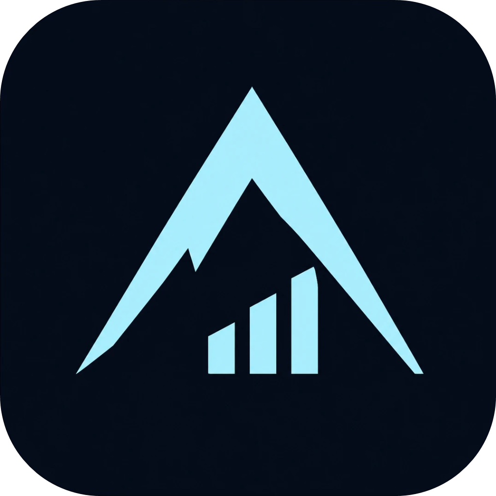
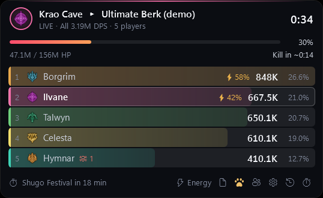
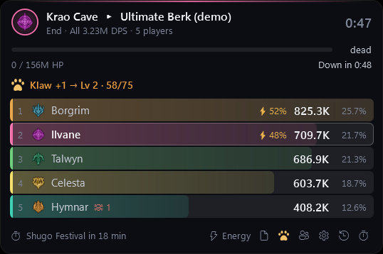
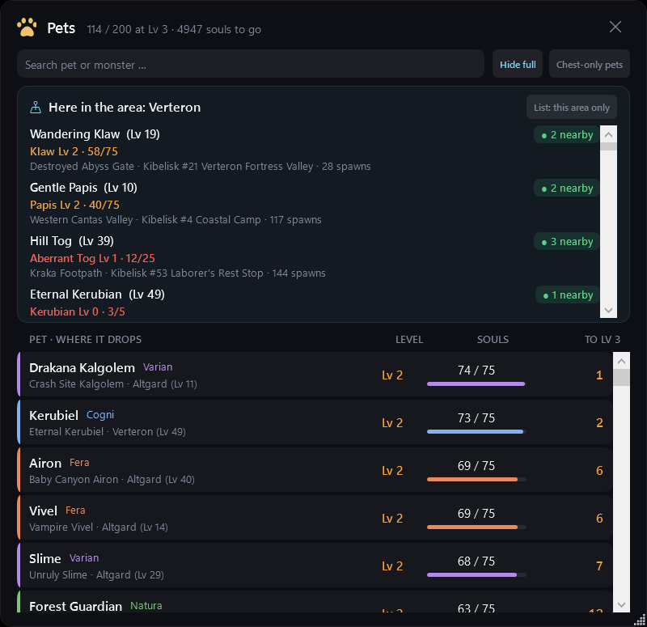
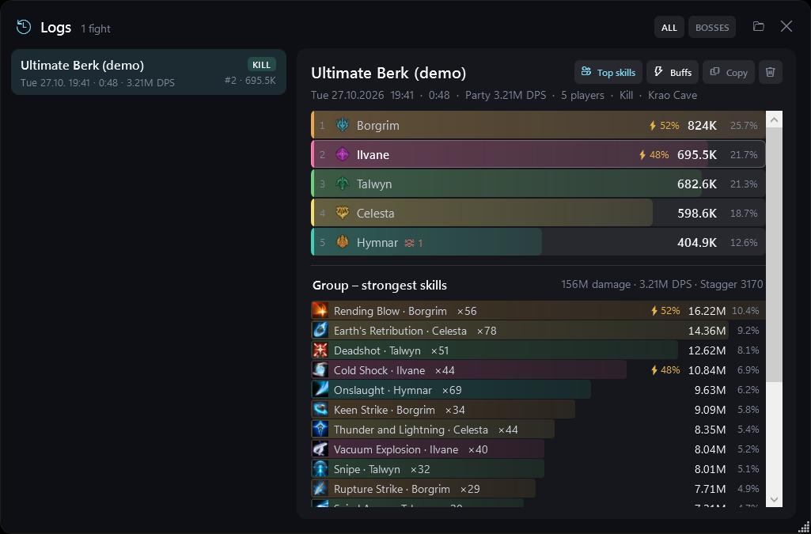
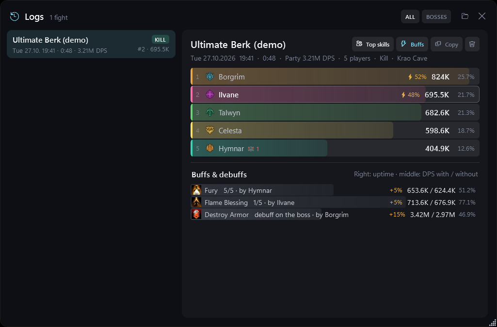
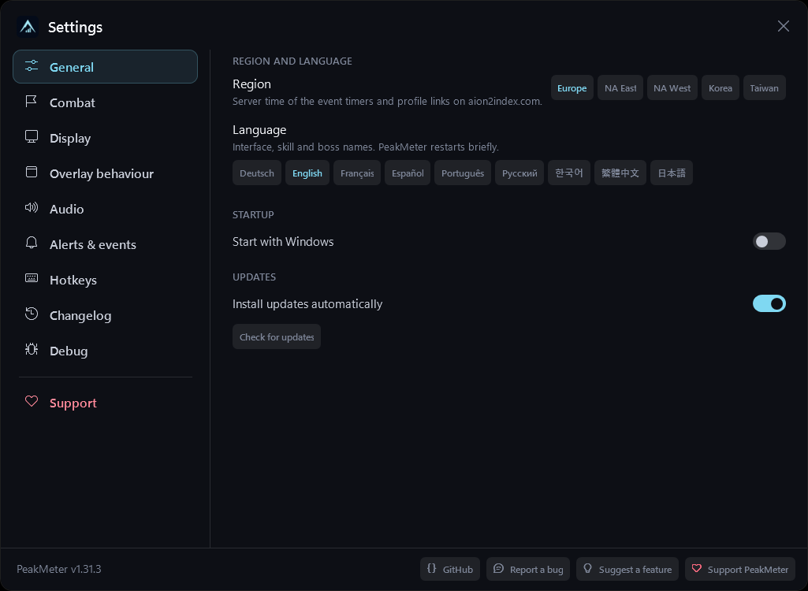

  

<h1 align="center">PeakMeter</h1>

  <b>A free, clean and lightweight DPS meter for AION 2 (EU / NA / Korea / Taiwan) – the AION 2 damage meter.</b> 
  Live damage, healing and tanking · stagger · deaths · buffs · pet souls · fight logs · event &amp; world boss timers · Odyle energy · 9 languages · updates itself.

  
  
  
  
  

  
  &nbsp;
  

<b><a href="https://peakmeter-ranking.peakmeter.workers.dev/">PeakMeter website</a></b> – download, AION 2 ranking per dungeon boss, player profiles with gear, Daevanion and titles, and the player duel.

<b>English</b> · <a href="#deutsch">Deutsch</a>

All screenshots use the built-in demo with made-up names.

## Features

### In the fight
- **Live overlay** – DPS, share and combat power per player, boss HP with time-to-kill, fight clock. Solo it shows only you, in a party only your party (like the game's own frames).
- **⚡ Stagger** – each player's share of the boss's stagger gauge, right next to their DPS.
- **☠ Deaths** – how often someone died in the fight, after their name.
- **DPS / HEAL / TANK** – damage dealt, healing done or damage taken; eDPS or aDPS.
- **Better than your best?** – live: your DPS against your best kill of this boss (else your last attempt), plus your best kill time.
- **Idle time & death recap** – click a player: seconds without an own hit, and at ☠ the hits that took them down.
- **Copy for Discord** – one click puts a picture of the fight on the clipboard; paste it with Ctrl+V.
- **Ranking (opt-in)** – the best DPS, healing and stagger per dungeon boss, overall, per class and per week. After a ranked kill the meter shows your place. [Ranking & download page](https://peakmeter-ranking.peakmeter.workers.dev)
- **Party** – level, gear score and combat power of every member, server tags like in game, a link to each player's PeakMeter profile (gear, stats, Daevanion, skills and their best kills).

### Pets

  

- **Pet souls at the monster** – hit a monster and the meter tells you which pet it feeds and how far along that pet is: 🟢 full, 🟠 level 2, 🔴 many souls missing. Right after a kill: the soul you just got. No more opening the pet menu to check.
- **Here in the area** – the pet window lists every monster on your current map whose souls you still need, with its area, the nearest Kibelisk, spawns, and how many are in view right now.
- **All pets** – level, souls, souls left to level 3 and where each pet drops; search by pet or monster, hide full pets, filter to this area. Can be switched off once you're done.

### Fight logs

  
  

- **Every fight saved** – ranking, every skill with hits, crit and max hit, its icon and its share of the stagger; best kills are marked.
- **Top skills** – the whole group's strongest skills in one list: who carried the fight with what.
- **Buffs** – every buff and every debuff on the boss: uptime and the DPS with and without it.

### Around the fight
- **Event timers** – Shugo Festival, air raid / dimensional invasion, Spacetime Rift, sieges, Nahma, resets … with a soft chime.
- **World boss timers** – all field bosses of Verteron and Altgard, exact respawn times from the game's own list.
- **Odyle energy** – read from the game, counted forward in between, for every character (hover the energy); "~" marks an estimate until the game sends the value.
- **Alerts at the right edge** – events, world bosses and full energy slide in as small cards.
- **Optional character portrait** – your official in-game portrait instead of the class emblem.

### Everywhere
- **9 languages** – English, Deutsch, Français, Español, Português, Русский, 한국어, 繁體中文, 日本語 (interface, skill, boss, buff and pet names).
- **Regions** – Europe, NA East, NA West, Korea, Taiwan (event times and profile links).
- **Settings like the big meters** – combat power or gear score next to names, total damage, hide player names (for streams), UI scale, refresh rate, focus mode, fade when idle, only over the game, custom hotkeys, start with Windows, **automatic updates**.
- **Light on your PC** – no GPU use, low priority; ~0.2 % CPU idle, ~65 MB RAM.

  

## Install

1. Install **[Npcap](https://npcap.com/#download)** (free capture driver, keep the default options).
2. Download the newest **`PeakMeter-v…-win-x64.zip`** from [Releases](https://github.com/Peakmeter/PeakMeter/releases/latest), unzip it.
3. Double-click **`PeakMeter installieren.cmd`** – it installs PeakMeter for your user (no admin), adds a desktop shortcut and starts it.
   If Windows says *"Windows protected your PC"*: *More info → Run anyway* (PeakMeter is not code-signed yet).
4. Start PeakMeter **before** logging in: names, your pets and your energy arrive at login and on loading screens.

| Key | |
|---|---|
| Ctrl+Shift+D | show / hide |
| Ctrl+Shift+R | reset |
| Ctrl+Shift+L | click-through |
| Ctrl + mouse wheel | background transparency |

Language, region, hotkeys and more: ⚙ in the overlay footer or right-click the tray icon.

## Is it safe?

PeakMeter only **reads your own game's network traffic** (like Wireshark) and only shows what already happened or what the game tells you anyway – no radar, no hidden information, no automation. It never touches game memory, never injects anything and never sends anything to the game. Still, any third-party tool may be against the game's terms of service – use it at your own risk. PeakMeter is a community project and not affiliated with NCSOFT.

PeakMeter itself only contacts `api.github.com` (update check), NCSOFT's image server for skill, buff and character pictures, and NCSOFT's character search for the optional portrait. While connected to the game it also raises an anonymous public counter on `abacus.jasoncameron.dev` once per 10 minutes and once per day, so we know how many people play with PeakMeter: no name, character, server or id is sent, only the number goes up. With the same setting it shares your server's world boss times (boss, server, when it comes back; no name or character) for the live timers on the website. Turn both off under Settings → "Count me anonymously". If you turn on Settings → "Join the ranking" (off by default), PeakMeter sends your own values after a dungeon boss kill (name, server, class, combat power, DPS, healing, stagger per second, fight time, party size) to the PeakMeter ranking server on Cloudflare (`tools/ranking-worker`); never anyone else's.

## Support

PeakMeter is free and stays free. If it helps you, a coffee on **[Ko-fi](https://ko-fi.com/peakmeter)** keeps it going. ☕
Bugs and ideas: [Issues](https://github.com/Peakmeter/PeakMeter/issues). The file `%AppData%\PeakMeter\peakmeter.log` helps (states and numbers only, no chat).

---

## Deutsch

**PeakMeter** ist ein kostenloser, schlanker DPS-Meter für AION 2 (EU / NA / Korea).

**Im Kampf**
- **Live-Overlay** mit DPS, Anteil und Combat Power, Boss-HP mit geschätzter Kill-Zeit – allein nur du, in der Gruppe nur deine Gruppe.
- **⚡ Stagger:** Wie viel jeder vom Stagger des Bosses macht, direkt neben der DPS.
- **☠ Tode:** Wie oft jemand im Kampf gestorben ist.
- **DPS / HEAL / TANK**, eDPS oder aDPS, **Live-Vergleich mit deinem besten Kill** und **Bestzeiten**.
- **Leerlauf & Todes-Analyse:** Klick auf einen Spieler zeigt die Sekunden ohne eigenen Treffer und bei ☠ die Treffer, die zum Tod geführt haben.
- **Für Discord kopieren:** Ein Klick legt ein Bild vom Kampf in die Zwischenablage – in Discord mit Strg+V einfügen.
- **Rangliste (freiwillig)** pro Dungeon-Boss für DPS, Heilung und Stagger – gesamt, pro Klasse und pro Woche; nach einem Kill zeigt der Meter deinen Platz.
- **Gruppe** mit Level, Gearscore, Combat Power, Server-Kürzel wie im Spiel und Link zum PeakMeter-Profil (Ausrüstung, Werte, Daevanion, Skills und Bestwerte).

**Pets**
- **Pet-Seelen beim Monster:** Haust du ein Monster, zeigt der Meter, für welches Pet es Seelen gibt und wie weit es ist – 🟢 voll, 🟠 Stufe 2, 🔴 fehlt noch viel. Nach dem Kill die Seele, die du gerade bekommen hast. Kein Pet-Menü mehr nötig.
- **Hier im Gebiet:** Das Pet-Fenster zeigt alle Monster auf deiner Karte, deren Seelen dir noch fehlen – mit Gebiet, nächstem Kibelisk, Spawns und wie viele gerade in der Nähe sind.
- **Alle Pets** mit Stufe, Seelen, wie viele bis Stufe 3 fehlen und wo sie droppen. In den Einstellungen abschaltbar, wenn du fertig bist.

**Logs**
- Jeder Kampf gespeichert, mit allen Skills, Icons und Stagger-Anteil.
- **Top-Skills:** die stärksten Skills der ganzen Gruppe.
- **Buffs:** jeder Buff und Boss-Debuff mit Uptime und DPS mit / ohne.

**Außerdem**
- **Event-Timer** (Shugo, Luftangriff, Riss, Belagerung, Nahma …) und **alle Weltbosse** mit sanftem Klingelton.
- **Odyle-Energie** aus dem Spiel, für alle Charaktere („~“ = geschätzt).
- **9 Sprachen** (Deutsch, English, Français, Español, Português, Русский, 한국어, 繁體中文, 日本語) und **Regionen** Europa, NA-Ost, NA-West, Korea, Taiwan.
- Optional dein **Charakterbild** statt Klassen-Logo, **Hinweise** am Bildschirmrand, **Einstellungen** wie bei den großen Metern, **automatische Updates**, schont den PC.

**Installieren:** [Npcap](https://npcap.com/#download) installieren → neueste ZIP unter [Releases](https://github.com/Peakmeter/PeakMeter/releases/latest) laden und entpacken → `PeakMeter installieren.cmd` doppelklicken. Bei „Der Computer wurde durch Windows geschützt“: *Weitere Informationen → Trotzdem ausführen*. PeakMeter **vor dem Einloggen** starten, dann kennt er Namen, Pets und Energie.

PeakMeter liest nur den Netzwerkverkehr deines eigenen Spiels – kein Speicherzugriff, nichts wird ans Spiel gesendet. Nutzung auf eigenes Risiko; kein offizielles Produkt von NCSOFT.

Gefällt dir PeakMeter? Unterstütze es auf **[Ko-fi](https://ko-fi.com/peakmeter)** ☕

---

## Build it yourself

.NET 10 SDK, then `powershell -ExecutionPolicy Bypass -File build.ps1` → `dist\PeakMeter-v<version>-win-x64.zip` (+ SHA-256).
`PeakMeter.exe --profile test --demo` runs the demo fight in a separate test profile.

## Credits &amp; license

Network decoding, combat tracking and game data (`src/AionMeter.Core`, `data/`) come from
[cyberbadger6969/aion2-dps-meter](https://github.com/cyberbadger6969/aion2-dps-meter) (GPL-3.0), whose data tables come from
[taengu/A2Tools-DPS-Meter](https://github.com/taengu/A2Tools-DPS-Meter) and
[Kuroukihime/AIon2-Dps-Meter](https://github.com/Kuroukihime/AIon2-Dps-Meter).
The stagger, buff and pet record layouts, buff names and pet data follow A2Tools-DPS-Meter and
[taengu/A2Tools-Plugins](https://github.com/taengu/A2Tools-Plugins) (GPL-3.0); details in `data/NOTICE.md`.
The interface, logs, timers, Odyle energy decoding, updater and installer are PeakMeter's own.
PeakMeter is therefore licensed under **GPL-3.0** (`LICENSE`). Game data and images © NCSOFT.
